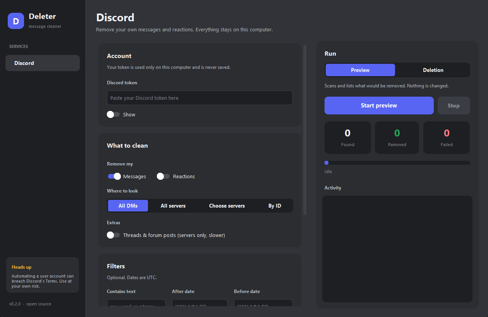

# Deleter

A small, open-source, local alternative to [Redact](https://redact.dev) for **Discord**. It bulk-removes your own messages and reactions from DMs, servers or chosen channels. Everything runs on your machine and your token is never saved.



- Clean all DMs, all servers, servers you pick, or specific channel/DM IDs (threads and forum posts optional)
- Filter by text, date range, or messages with files, links or embeds
- **Preview** mode shows what would be removed without touching anything
- Random pacing, rate-limit handling, live progress, Stop button
- Optional local archive of removed items (JSON Lines in `~/Deleter/archives`)

> **Warning:** automating a user account violates Discord's Terms of Service. Use at your own risk and never share your token.

## Run

**Windows:** double-click `Deleter.bat` (no terminal, installs packages on first start). To get a single shareable file, run `build_exe.bat` once and use `dist\Deleter.exe`.

**Anywhere:**

```bash
pip install -r requirements.txt
python deleter.py
```

On Linux install Tk first, and add `--break-system-packages` to pip if your distro refuses a system-wide install:

```bash
sudo pacman -S tk                  # Arch
sudo apt install python3-tk        # Debian/Ubuntu
sudo dnf install python3-tkinter   # Fedora

pip install -r requirements.txt --break-system-packages
```

Always start with **Preview** and read the log before switching to **Deletion**.

## Development

```bash
python -m unittest
```

`deleter_app/core.py` is the engine (HTTP client, filters, runner), `deleter_app/services/discord.py` the Discord logic, `deleter_app/gui.py` the customtkinter GUI and `deleter_app/anim.py` the animation helpers.
